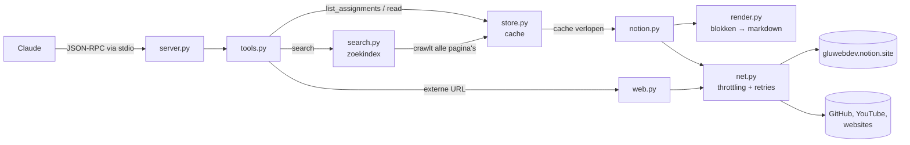

# Hoe het werkt

Dit document legt uit hoe de server de Notion-site leest, omzet en doorzoekbaar maakt, en waarom het zo gebouwd is.

## Overzicht



1. Claude start de server als subproces en praat ermee via stdin/stdout (het [MCP-protocol](https://modelcontextprotocol.io)).
2. Een tool-call gaat naar `tools.py`, die bepaalt wat er gelezen moet worden.
3. Notion-pagina's komen uit de cache (`store.py`). Ontbreken ze of zijn ze verlopen, dan worden ze opgehaald (`notion.py`) en omgezet naar markdown (`render.py`).
4. Op de achtergrond crawlt `search.py` alle pagina's, zodat zoeken over de hele site werkt.

## De Notion-API

Notion heeft een officiële API, maar die werkt alleen met een integratie-token voor pagina's die je zelf beheert. Voor de openbare GLU-site gebruikt de server daarom dezelfde interne endpoints als de Notion-website in je browser. Daar is geen login voor nodig, maar ze zijn niet gedocumenteerd en kunnen in de toekomst veranderen.

| Endpoint | Waarvoor |
|----------|----------|
| `POST /api/v3/loadCachedPageChunkV2` | Een pagina met haar blokken laden. Grote pagina's komen in stukken; het antwoord bevat dan `cursors`, en die stuur je terug voor het volgende stuk. |
| `POST /api/v3/syncRecordValuesMain` | Losse records ophalen die nog ontbreken: diep geneste blokken, synced blocks, databaserijen en titels van gementionde pagina's. Maximaal 100 per request. |
| `GET www.notion.so/image/<bron>?table=block&id=…&width=1000` | Afbeeldingen via de image-proxy van Notion, direct verkleind. |

Een paar eigenaardigheden die de code opvangt:

- **Dubbel genest formaat.** Een record staat in `recordMap.block[id].value.value`; oudere antwoorden hebben één laag minder. `Raw.merge` kan met beide overweg.
- **Lazy loading.** Niet alle geneste blokken zitten in de eerste response. `_complete()` loopt de blokkenboom af en haalt in batches op wat ontbreekt, tot alles compleet is.
- **Eén ongeldige id laat een hele batch falen.** `Raw.fetch` splitst de batch dan steeds in tweeën, tot de foute id gevonden is.
- **Databases.** Het endpoint `queryCollection` geeft voor openbare pagina's niets terug. De rijen staan wel in `page_sort` van de database-view, en worden daarna met `syncRecordValuesMain` opgehaald.
- **Rate limiting.** Bij te veel requests geeft Notion een `429`. `net.py` laat daarom maximaal 3 requests tegelijk toe (`GLU_WORKERS`), en probeert het bij een 429 of serverfout opnieuw met oplopende wachttijd (1, 2, 4, 8… s). Een `Retry-After`-header wordt gerespecteerd.

## Van blokken naar markdown

`render.py` zet elk bloktype om naar zo compact mogelijke markdown:

| Notion | Markdown |
|--------|----------|
| Koppen (H1–H4) | `##` t/m `#####` (`#` is de paginatitel) |
| Tekst met opmaak | `**vet**`, `` `code` ``, `~~doorgehaald~~`, `[tekst](url)`. Kleuren en onderstrepen vallen weg. |
| Opsommingen, genummerd, to-do, toggle | `- `, `1. `, `- [x] `, met inspringing voor geneste items |
| Code | blok met taal, bv. ` ```php ` |
| Callout / quote | `> 💡 tekst` |
| Tabel | `\|a\|b\|` (zonder overbodige spaties) |
| Database | tabel met de titel en max. 5 zichtbare kolommen; rijen met inhoud worden links |
| Subpagina, link, @-mention, alias | `[Titel](@ref)` |
| Afbeelding | `[img: naam](@ref)`; lezen geeft de afbeelding zelf |
| Bookmark, embed, video, bestand | `[video: titel](url)`; bestanden die bij Notion zelf staan alleen met hun naam |
| Kolommen, synced blocks, tabs | de inhoud, platgeslagen |
| Scheidingslijn, inhoudsopgave, knoppen | weggelaten |

Tijdens het renderen verzamelt de renderer ook alle Notion-pagina's waarnaar gelinkt wordt (`links`). De crawler gebruikt die lijst.

### Opdrachten per leerjaar

Op de hoofdpagina staan de leerjaren in kolommen. Elke kolom begint met een tekstblok *"Leerjaar N"*, gevolgd door de opdrachtpagina's. `parse_assignments()` leest die structuur uit en haalt uit elke titel drie dingen:

- de periode (`3.1`);
- het type (`module`, `ontwikkelweek` of `overig`);
- een opgeschoonde naam: van *"3.1 - Module - Webshop (Front-end Statisch)"* blijft *"Webshop (Front-end Statisch)"* over.

Pagina's buiten de kolommen komen onder de kop die erboven staat, zoals *Stage* of *Loopbaan*.

## Korte refs (`refs.py`)

Een Notion-id als `b8d9ced7-98b7-41d3-a375-fcafbb470a43` kost ongeveer 25 tokens. Op een pagina met 40 links is dat 1000 tokens aan id's. De server gebruikt daarom korte refs:

- **Notion-pagina's en afbeeldingen**: de laatste 8 hex-tekens van het id (`@bb470a43`). Is die combinatie al bezet, dan wordt de ref langer.
- **Externe URL's** (op websites): 8 tekens van de sha1-hash.

De refs worden bewaard in `refs.json` in de cachemap, zodat ze ook in een volgend gesprek nog werken. Draaien er meerdere serverprocessen tegelijk, bijvoorbeeld Claude Desktop én Claude Code? Dan voegt elk proces bij het opslaan eerst de refs van de anderen samen, en zoekt het een onbekende ref ook nog op de schijf op.

## Cache (`store.py`)

- Elke gerenderde pagina wordt opgeslagen als `docs/<id>.json`: titel, markdown, links en tijdstempel.
- Een pagina is 12 uur geldig (`GLU_CACHE_HOURS`). Daarna wordt hij bij het lezen opnieuw opgehaald. Lukt dat niet, bijvoorbeeld omdat je offline bent, dan krijg je de oude versie.
- Elke pagina krijgt een `RENDER_VERSION` mee. Verandert de code de output, dan wordt dat getal opgehoogd en worden oude pagina's automatisch vervangen.
- Vragen twee tool-calls tegelijk dezelfde pagina op, dan wacht de tweede op de eerste. Zo gaat er geen dubbel request uit.
- Bestanden worden atomisch geschreven (eerst naar een `.tmp`-bestand, dan hernoemen), zodat een half geschreven cache niet kan bestaan.

## Crawler en zoekindex (`search.py`)

Zoeken over de hele site kan alleen als alle pagina's bekend zijn. De crawler werkt zo:

1. Hij begint bij de hoofdpagina en loopt breadth-first langs alle `links` van elke pagina. Alleen pagina's binnen de GLU-workspace worden verder gevolgd.
2. Per pagina onthoudt hij bij welke opdracht die hoort. Zo kan een zoekresultaat tonen: *"… · 9.1 OOP & Laravel"*.
3. Na elke laag slaat hij de voortgang op in `index.json`. Zoeken werkt dus al tijdens het crawlen, met de melding dat de index nog niet compleet is.
4. Een lockbestand zorgt dat er maar één crawler tegelijk draait, ook als er meerdere serverprocessen zijn.

Een volledige crawl van ±1000 pagina's duurt ongeveer 6 minuten, gebonden aan de rate limit van Notion. Bij het starten kijkt de server of de index ouder is dan 12 uur, en ververst hem dan op de achtergrond.

Zoeken zelf gebeurt in het geheugen en duurt minder dan een halve seconde:

- Hoofdletters en accenten tellen niet mee.
- Alle zoekwoorden moeten in de pagina voorkomen.
- Treffers in de titel tellen zwaarder.
- Per resultaat krijg je een fragment rond de eerste treffer, zonder markdown-tekens.

## Externe links (`web.py`)

| Bron | Wat de server teruggeeft |
|------|--------------------------|
| GitHub-repo | bestandslijst en README via de GitHub-API |
| GitHub-bestand | ruwe inhoud via `raw.githubusercontent.com` |
| YouTube | titel en kanaal via oEmbed (een transcript is zonder API-sleutel niet beschikbaar) |
| Afbeelding | de afbeelding zelf, als MCP-image |
| PDF | alleen een melding; PDF-tekst lezen zou een dependency vereisen |
| Overige HTML | de hoofdinhoud als markdown |

Bij HTML is het doel: alleen de echte inhoud, zo kort mogelijk. Daarvoor doet de server het volgende:

- Hij slaat `script`, `style`, `nav`, `header`, `footer`, `aside` en `form` over.
- Hij kiest de beste container voor de hoofdinhoud: `<main>`, dan `role="main"`, dan `id="main"`/`"content"`, dan `<article>`.
- Hij verwijdert regels die vooral uit links bestaan, zoals menu's, breadcrumbs en tags.
- Lange lijsten met alleen links kort hij in.
- Links worden korte refs, zodat Claude ze kan volgen zonder dat elke URL tokens kost.

## Lange pagina's (`paging.py`)

Een antwoord is maximaal 12.000 tekens (`GLU_MAX_CHARS`), ongeveer 3000 tokens. Een langere pagina gaat zo:

- Hij wordt op regelgrenzen opgedeeld, bij voorkeur vlak voor een kop.
- Het eerste deel eindigt met een lijst `[koppen → deel: …]`, zodat Claude gericht verder kan lezen.
- Met `section="…"` krijg je alleen die kop met alles eronder, tot de volgende kop van hetzelfde niveau.

## Het MCP-protocol (`server.py`)

MCP via stdio is JSON-RPC 2.0, met één JSON-bericht per regel. De server ondersteunt `initialize`, `ping`, `tools/list` en `tools/call`. Dat is alles wat nodig is voor tools.

Er is bewust gekozen voor een eigen implementatie in plaats van de officiële Python-SDK:

- **Geen installatie**: `python server.py` werkt direct, zonder `pip install`. Dat maakt het voor medestudenten makkelijker.
- **Snel opstarten**: geen zware imports, de server staat er binnen 0,2 s.
- **Klein**: het protocol-deel is ±100 regels.

Tool-calls worden parallel afgehandeld in een threadpool. Een fout in een tool wordt teruggegeven als `isError`-resultaat, zodat Claude ziet wat er misging en de server blijft draaien. Logs gaan naar stderr, want stdout is van het protocol.

## Bekende beperkingen

- De Notion-endpoints zijn niet officieel. Verandert Notion ze, dan moet `notion.py` worden aangepast.
- Pagina's en databaserijen die niet openbaar zijn, kunnen niet gelezen worden.
- Wat niet gelezen kan worden: PDF-inhoud, video-inhoud, YouTube-transcripts, en sites waar je moet inloggen (ELO, GitHub Classroom).
- Formules en rollups in databases worden niet getoond: hun waarden berekent Notion pas in de browser.
